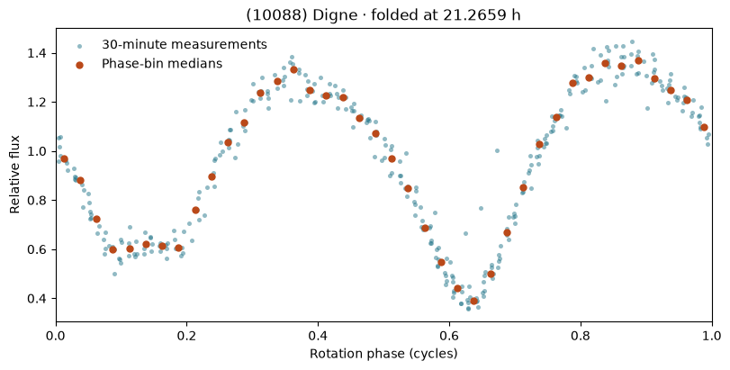

# tess_sso

Extract asteroid light curves from TESS full-frame images. `tess_sso` downloads
the pixels along the predicted track, models scattered light and field stars,
and measures the asteroid flux with a moving pixel response function (PRF).

## Example · (10088) Digne

The [photometry notebook](examples/digne/photometry.ipynb) follows Digne across
sector 72, measures its flux in 30-minute groups and folds the light curve at
the previously measured period of **21.2659 hours**. The two brightness minima
have different depths.



## Run the notebook

From a checkout with Python 3.12 or later:

```sh
python -m pip install -e . jupyterlab matplotlib
python -m jupyterlab examples/digne/photometry.ipynb
```

The first run needs internet access and about 2.4 GB for Digne’s pixel data.
Downloaded pixels are reused from `data/tess_sso/`. Set `TESS_SSO_DATA` to
choose another storage directory.
